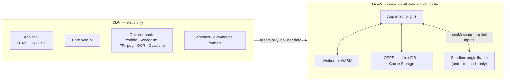
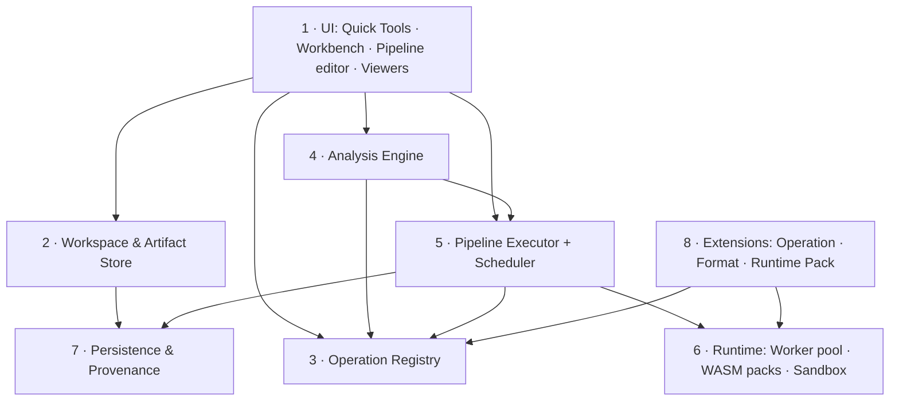

# CTF Workbench — Architecture and Implementation Plan v1

Restructured from `plan.md`, which contains three successive iterations of the same discussion:

1. A gap analysis of real CTF write-ups (24 tool modules plus a set of reusable operation primitives).
2. A full product architecture that assumed an optional isolated backend.
3. A re-plan under a new constraint: **browser-only, CDN static hosting, no server-side compute**.

Where the iterations disagree, the latest decision wins. Every backend-dependent idea from iterations 1 and 2 has been either re-scoped to the browser, demoted, or moved to non-goals. Section 3.2 lists each one.

---

## 0. Decisions at a glance

| Area | Decision |
|---|---|
| Product core | Artifact-first workbench. Quick tools are an entry point into the same engine, not a separate product |
| Deployment | 100% static assets (HTML, JS, CSS, WASM, schemas, dictionaries) on a CDN. Cloudflare Pages first choice |
| Server side | None. No compute backend, no accounts, no database, no upload API |
| Compute order | TypeScript in Web Workers → WASM when TS is too slow or a mature native implementation exists → Pyodide for Python. Never a backend fallback |
| Data model | Immutable Artifacts over a single `ByteSource` abstraction. Every change creates a new Artifact |
| Persistence | IndexedDB (metadata) + OPFS (bytes) + Cache Storage (app assets). The exported `.ctfwork` file is the real backup |
| Tool protocol | Typed, versioned Operations in one registry. The UI never knows about individual tools |
| Analysis | Detector → Finding → Candidate → Validation, with explicit compute budgets |
| Workflow | Linear Recipe first, DAG second, same JSON format |
| File formats | Kaitai Struct schemas for parsing, plus a separate Patch Engine for edits |
| Isolation | Workers give responsiveness, not security. Untrusted code runs only in a sandboxed cross-origin iframe or a constrained WASM runtime. Suspected malware is analysed statically only |
| First vertical slice | PNG/BMP repair → LSB extraction → decode |
| Quality bar | Golden vectors, real write-up regression fixtures, and an automated network-egress test that proves no user data leaves the browser |

---

## 1. Product

### 1.1 Goal

Take any text, file, image, capture or binary and keep identifying, extracting, transforming, validating and analysing it, without leaving the page, without writing throwaway scripts, and without uploading anything. Every step keeps its inputs, parameters, outputs and provenance, and any intermediate result can feed any other tool.

### 1.2 Four usage modes on one engine

| Mode | Example | Must not require |
|---|---|---|
| Quick Tools | Paste Hex, get ASCII | A project, a pipeline, or understanding Artifacts |
| Workbench | Import `challenge.zip`, explore attachments, keep every intermediate result | — |
| Pipeline | CyberChef-style chains, but multi-input, branching, large files | — |
| Assisted solving | The system proposes evidence-backed next steps and runs bounded, side-effect-free searches | Trusting an unverified "flag" |

All four modes call the same Operation Registry and Pipeline Executor. There is no second implementation of any tool.

### 1.3 Target experience

1. The user drags `challenge.zip` in. It is detected, listed, and checked for encryption, trailing data and structural anomalies.
2. The user opens the PNG inside. The structure view flags an inconsistent IHDR, and clicking the finding highlights the bytes in the Hex view.
3. The user picks a candidate height. `repaired.png` is created, the original is untouched, and validation re-runs automatically.
4. The bit-plane view finds a channel order that yields a file signature. The extracted bytes become a new Artifact, are detected as compressed, decompress, and produce a candidate flag.
5. The user exports the repaired image, the extracted file, the full Recipe, the provenance graph and an evidence report. Reopening the workspace later resumes from any step.

### 1.4 Non-goals (v1)

- No online judge, no CTF hosting platform, no accounts or team cloud workspaces.
- No "solve any challenge automatically" AI.
- No rewrite of Ghidra, Wireshark, FFmpeg or SageMath. Use WASM ports where they exist; otherwise state the limitation.
- No public third-party plugin marketplace.
- No generic raw TCP/UDP client, no native process execution or debugging, no native-equivalent C++ judging.
- No attempt to cover every file format in the first releases.
- No single universal JSON shape forced on every analysis result.

---

## 2. Design principles

1. **Artifact → Operation → Artifact.** Replace "input box → output box → copy → next tool → paste". Every intermediate result is a first-class, previewable, downloadable object.
2. **Non-destructive by default.** Edits (field patches, byte deletions, Hex edits) go into a patch overlay and materialise as a new Artifact. This gives undo, redo, comparison and branching for free.
3. **Data is separate from its presentation.** Switching between Hex, ASCII, binary or decimal is a *View* and never changes bytes. The vocabulary is fixed:

   | Concept | Behaviour | Example |
   |---|---|---|
   | View | Changes display only | Bytes shown as Hex |
   | Convert | Explicit type change | Hex string parsed into Bytes (charset must be stated) |
   | Transform | Changes content | XOR, bit reverse |
   | Parse | Interprets structure | PNG chunks, ELF header |
   | Analyze | Produces findings or candidates | Type detection, stego scan |
   | Execute | Runs code | Pyodide script |
   | Validate | Tests a hypothesis | CRC check, test decompression |

   Lossy or ambiguous conversions, such as string to bytes, require an explicit choice. This prevents the classic bug of "reversing the hex characters instead of the bytes".
4. **Raw data, findings and candidates are separate records.** Seeing `PK` at offset 0x1234 is a *Finding*; "a ZIP can be carved there" is a *Candidate*; "it parses and extracts" is a *Validation*; the byte range and rule that matched are the *Evidence*.
5. **Local-first is a public promise.** Opening a file in the page never sends it anywhere. Shared Recipes contain operations and parameters, never attachments, keys or content.
6. **Every search is bounded.** Depth, candidate count, time and bytes processed all have budgets. Operations with side effects never run automatically.
7. **Static analysis first for hostile content.** Scripts, pickles and binaries from a challenge are parsed, never `eval`-ed or executed in the app context.

---

## 3. The browser-only constraint

### 3.1 Capability tiers

**Tier 1 — Pure TypeScript, fully achievable**

Encodings (Base family, Hex, URL, HTML entities, Unicode); byte and bit operations; classical ciphers; hashes, AES, RSA, ECC and number theory (Web Crypto plus JS/WASM); Hex editor, strings, entropy, magic detection; PNG/BMP structure, CRC, LSB and bit planes; QR decode and structural repair; ZIP, Gzip, Zlib, Deflate and Brotli; JSON, XML, CSV, JWT and regex; FFT and spectrograms via Web Audio; detection and candidate search; Recipes and DAGs.

**Tier 2 — WASM or existing browser ports, realistic**

| Capability | Candidate implementation | Note |
|---|---|---|
| Python execution | Pyodide in a Worker | Only pure-Python wheels or packages built for Pyodide |
| Deep PCAP dissection | Wiregasm / webShark-style WASM Wireshark | Load on demand; a TS reader handles cheap scans |
| SQLite | sql.js | |
| Git objects | isomorphic-git plus custom dangling-object analysis | |
| Disassembly | Capstone (JS/WASM) | |
| OCR | Tesseract.js | |
| Image processing | OpenCV.js or own WASM | |
| Audio and video | FFmpeg.wasm | Multithreaded build needs cross-origin isolation |
| Format parsing | Kaitai Struct JS runtime plus `.ksy` library | |
| Heavy crypto or maths | Rust/C → WASM | |
| C/C++ compile and run | WASM Clang + WASI | Experimental; not in the committed scope |
| x86 emulation | v86 | Heavy; later and optional |

**Tier 3 — Hard browser limits, and how the plan handles them**

| Capability | Limit | Handling |
|---|---|---|
| Raw TCP/UDP | No socket API in web pages | Not offered. WebSocket targets only, opt-in |
| Arbitrary HTTP requests | CORS | Only CORS-enabled targets, opt-in. Offline HAR/Burp import otherwise |
| Native ELF/PE execution, GDB, ptrace | No host process access | Static analysis, WASM, or emulators only |
| Native-equivalent judging | WASM ≠ native toolchain | Offer an experiment sandbox only |
| Live memory acquisition | Not possible | Analyse imported memory images |
| Large brute force | Device CPU and memory | Budgets, pause and resume; export hashcat/John formats for offline use |
| DNS, WHOIS, cloud API queries | No raw network | Offline log and record parsing only |
| Cross-device sync | No server storage | Export and import workspaces |

### 3.2 Re-scoping of backend-dependent ideas from earlier iterations

| Earlier idea | Earlier assumption | Browser-only treatment | Priority |
|---|---|---|---|
| Isolated Runner (Ghidra, SageMath, native tools, dynamic analysis) | Container backend | Dropped. Replaced by on-demand **Runtime Packs** (WASM ports) | — |
| Tool Adapters (zsteg, binwalk, tshark, exiftool…) | Native binaries | Re-implement the needed subset in TS, or use a WASM port. Each adapter becomes a Runtime Pack or a set of Operations | — |
| Remote Interaction Studio (pwntools-style) | Backend TCP gateway | **Interaction Studio**: design the exchange state machine, replay imported transcripts, test against a local mock, export a pwntools script. Live connections only to WebSocket targets | P0 → P2 |
| Oracle Workbench | Backend probes | Local simulated oracles plus script export. Live probing only via WebSocket or CORS targets | P1 |
| Web Request Differential Lab | Backend HTTP client | Offline diffing of imported HAR/Burp/OpenAPI requests. Live sending only to CORS-enabled targets, opt-in | P1 |
| Cloud forensics online queries | Backend credentials | Offline CloudTrail, IAM, Kubernetes and Terraform files only | P1 |
| LLM / prompt testing | Backend model access | Optional external connector, browser to provider with the user's own key, off by default. Model-file forensics stays fully offline | P2 |
| Blockchain local test chain | Foundry on a server | Offline ABI, RLP, slot and selector tools. JSON-RPC to a user-supplied CORS endpoint, opt-in. An in-browser EVM (e.g. ethereumjs) is a candidate to evaluate | P1 |
| Password recovery at scale | GPU server | Bounded in-browser testing; WebGPU later. Always offer hashcat/John export | P1 |

**Rule for all connectors:** anything that leaves the browser is opt-in per workspace, shows exactly what will be sent, and is recorded in provenance. The automated analysis engine can never trigger it.

---

## 4. Architecture

### 4.1 Deployment view



- **Hosting:** Cloudflare Pages or Netlify (both support a `_headers` file). GitHub Pages is acceptable only for a single-threaded build because it offers limited header control.
- **Headers:** `Cross-Origin-Opener-Policy: same-origin`, `Cross-Origin-Embedder-Policy: require-corp`, `X-Content-Type-Options: nosniff`, plus a strict CSP. Verify at runtime that `crossOriginIsolated === true` before enabling threaded WASM.
- **Fixed production origin from day one.** Browser storage is per origin, so changing domain later orphans every user's workspaces.
- **A separate sandbox origin** (for example `sandbox.<domain>`) hosts the iframe that runs untrusted code. It must also satisfy COEP and CORP.
- **Routing:** Hash router, or a CDN SPA fallback, so deep links such as `/tools/png` don't 404.
- **Assets:** all third-party WASM and JS is version-pinned and served from the project's own origin. Nothing is fetched from public CDNs at runtime.
- **PWA:** a *Core Cache* (shell, encoders, Hex, PNG/BMP) is cached on first load. *Optional Packs* are cached on first use or on an explicit "download for offline" action.

### 4.2 Logical components



These are module boundaries inside one Vite application, not services.

| Component | Owns | Does not own |
|---|---|---|
| UI | Layout, viewers, forms generated from schemas, linked selection | Any data processing |
| Workspace & Artifact Store | Artifacts, ByteSources, patch overlays, notes | How Artifacts were produced |
| Operation Registry | IDs, versions, type checks, parameter schemas, capability and permission flags, runtime routing, search | UI, file pickers, history |
| Analysis Engine | Detectors, analyzers, explorers, findings, candidates, scoring, budgets | Executing operations directly |
| Pipeline Executor | Scheduling, DAG evaluation, caching, invalidation, cancellation, lazy materialisation | Operation logic |
| Runtime | Worker pool, WASM pack loading, sandbox bridge, transfer of buffers | Business logic |
| Persistence & Provenance | IndexedDB schema, OPFS layout, OperationRun records, export and import, migrations | — |
| Extensions | Registration of new Operations, Formats and Runtime Packs | Changing core UI |

### 4.3 Core data model

**ByteSource** — the only way any component reads bytes. Nothing calls `file.arrayBuffer()` on a whole file.

```ts
interface ByteSource {
  readonly size: number;
  read(offset: number, length: number): Promise<Uint8Array>;
  stream(start?: number, end?: number): ReadableStream<Uint8Array>;
}

type ArtifactSource =
  | { kind: "file"; file: File }                               // runtime only
  | { kind: "opfs"; path: string }                             // persistent
  | { kind: "slice"; parentId: string; offset: number; length: number }
  | { kind: "concat"; parts: { artifactId: string; offset: number; length: number }[] }
  | { kind: "memory"; bytes: Uint8Array };                     // runtime only, small
```

- `slice` and `concat` avoid copying. For example, a TCP payload references the original capture, and a reassembled stream is a virtual concatenation.
- Transformed outputs (XOR, decompress) are materialised to OPFS when they are persisted, previewed beyond a window, or consumed downstream.
- `file` and `memory` sources are never serialised as-is. On persist they are written to OPFS, or the file is marked as "needs re-selection".

**Core value types** (kept deliberately small):

| Type | Use |
|---|---|
| `Bytes` | Raw data, file contents |
| `Text` | Text with an explicit charset |
| `Number` | Number, BigInt, fixed or float |
| `Structured` | JSON, records, field trees, tables |
| `Collection` | Multiple artifacts, frames, records |
| `EventStream` | Packets, key events, log events with timestamps |

Images, audio and ELF files start as `Bytes`. Parsing produces structured or derived Artifacts, for example `PNG Bytes → PNG Metadata → Pixels → Bit planes → Extracted Bytes`.

**Analysis records:**

```ts
interface Finding   { id; artifactId; ruleId; severity: "strong" | "medium" | "weak"; message; span?: SourceSpan; evidence: Evidence[] }
interface Candidate { id; fromFindingId?; proposedOperation: OperationRef; params; score: EvidenceScore; status: "proposed" | "validated" | "rejected" }
interface Evidence  { kind: "signature" | "structure" | "integrity" | "decode" | "plausibility" | "targetMatch" | "consistency"; detail; span?: SourceSpan }
interface SourceSpan { artifactId: string; offset: number; length: number }
```

**Provenance:**

```ts
interface OperationRun {
  id: string;
  operationId: string; operationVersion: string;
  inputArtifactIds: string[]; inputHashes: string[];
  parameters: Record<string, unknown>;
  outputArtifactIds: string[];
  status: "success" | "partial" | "failed" | "cancelled";
  runtime: "ts" | "wasm" | "pyodide" | "sandbox";
  engineVersion: string; seed?: string;
  startedAt: string; finishedAt?: string; diagnostics?: string[];
}
```

Source spans are kept where a byte-accurate mapping exists, such as parsed fields and slices. After compression, hashing or encryption, only operation-level provenance is kept. Offsets are never invented.

### 4.4 Operation SDK

```ts
interface OperationSpec {
  id: string;                 // "bytes.reverse"
  version: string;            // semver; Recipes pin it
  title: string; category: string;
  inputs:  { name: string; type: ValueType; required?: boolean; multiple?: boolean }[];
  outputs: { name: string; type: ValueType }[];
  parametersSchema: JSONSchema;          // drives auto-generated forms and validation
  runtime: "ts" | "wasm" | "pyodide" | "sandbox";
  deterministic: boolean;                // same input + params → same output
  streaming: boolean;                    // must handle chunk boundaries correctly
  reversible?: OperationRef;             // e.g. XOR with the same key
  sideEffects: "none" | "network" | "codeExecution";
  partialResults: boolean;               // parsers return what parsed plus the error position
  cost: "low" | "medium" | "high";
  limits?: { maxInputBytes?: number; maxOutputBytes?: number };
}
```

- Operations implement `run(ctx, inputs, params)` only. The SDK supplies readers and writers, cancellation (`AbortSignal`), progress, budget enforcement and error mapping.
- The registry rejects incompatible connections, routes operations to runtimes, enforces permissions (`sideEffects ≠ none` is never auto-run), and caches deterministic results by `(operationId@version, inputHashes, params)`.
- Failure is a distinct result state. "Decode failed" can never come back as an empty successful output.

### 4.5 Pipeline Executor

- **Format:** JSON with `schemaVersion`, `nodes` (pinned `op@version` and `params`) and `edges`. Inputs are bound at runtime (`input.artifact`), so files are never embedded. The same JSON drives the linear Recipe UI, the DAG editor, and later a headless CLI.
- **Node kinds:** Source, Transform, Extract, Parse, Analyze, Validate, Branch, Filter, Map, Merge, Iterate (bounded), Script (sandboxed), Export.
- **The DAG is static.** Loops exist only inside an `Iterate` node with an explicit budget. Cycles between arbitrary nodes are disallowed.
- **Execution:** topological order; independent nodes run in parallel; deterministic nodes are cached; an upstream change invalidates only downstream nodes; a single node can be re-run; a failure keeps all earlier outputs; every node reports duration, status and errors; everything is cancellable.
- **Lazy materialisation:** large outputs are produced only when previewed, downloaded or consumed.
- **Delivery order:** linear Recipe first (M3), full DAG and editor second (M4).

### 4.6 Analysis Engine

| Stage | What happens | Cost |
|---|---|---|
| A. Cheap scan | Head and tail magic, size, charset, printable ratio, sampled entropy | Reads a few KiB |
| B. Structural scan | Lightweight parsers for candidate formats: PNG/CRC, ZIP directory, ELF, PE, PCAP, SQLite, PDF, Gzip | Format-bound |
| C. Hypotheses | Explainable suggestions, such as "IHDR CRC mismatch: check dimensions" or "ZIP structure at tail: carve" | — |
| D. Bounded exploration | Side-effect-free, low-cost operations over limited parameter ranges; outputs are re-detected | Budgeted |
| E. Validation and ranking | Structural integrity, CRC, test decompression, text plausibility, target patterns | — |

- **Scan levels:** *Quick* (stages A–C), *Deep* (A–C with full structural checks), *Explore* (A–E).
- **Evidence tiers:** strong, medium and weak. No fake probability percentages. Known traps are built into the rules: high entropy is not encryption, `PK` is not a ZIP, a regex flag match is not a correct answer, and a CRC match proves only the CRC.
- **Search** is a bounded beam search, de-duplicated by `(inputHash, opId, params)`. Initial budgets, to be tuned by benchmark:

  | Budget | Initial value |
  |---|---|
  | Decode depth | 3 |
  | Active candidates | 100 |
  | Kept per branch | 20 |
  | Time per round | 5 s |
  | Total bytes processed | 128 MiB |
  | Side-effecting operations | Never |
  | Network or upload | Never |

- **Candidate Explorer:** every candidate shows its score dimensions, reasons, source offsets and full operation path. Users can accept, reject or edit a candidate, and the result is turned into Pipeline nodes.

### 4.7 Runtime and isolation

**Worker types** (created on demand, pooled, never all at once):

| Worker | Responsibility |
|---|---|
| `general` | Encoding, byte transforms, text |
| `analysis` | Detection, signatures, candidate search |
| `storage` | OPFS random access via `FileSystemSyncAccessHandle` |
| `python` | Pyodide |
| `media` | FFmpeg.wasm, audio analysis |
| `pcap` | Wiregasm deep dissection |
| `reverse` | Capstone and static reverse tooling |

**Lazy loading:** using Base64 never downloads Pyodide, Wiregasm or FFmpeg. Packs load when their first operation is requested.

**Isolation rules:**

1. Same-origin Workers are not a security boundary.
2. User-written code (Pyodide scripts, JS snippets) runs in the Python worker or in the sandbox-origin iframe with `sandbox="allow-scripts"` and **without** `allow-same-origin`. It receives only explicit inputs via `postMessage`.
3. Third-party plugins (later) run only in the sandbox origin.
4. Challenge samples (PowerShell, JS, pickles, `.pyc`, binaries) are never executed. They are parsed with ASTs, opcode disassemblers and structure parsers.
5. Every task has cancellation, time and size budgets, and a hard stop: terminate and recreate the Worker. The browser cannot enforce exact CPU or memory quotas, so this is best-effort containment, not container-grade isolation.
6. Large buffers move via Transferables, Blob or File references and streams. `SharedArrayBuffer` is used only when cross-origin isolation is active.

**Known trap: Canvas is not a pixel source of truth.** Colour management, premultiplied alpha and 16-bit or palette images can alter values. Stego and pixel analysis must use raw decoders for PNG, BMP and GIF. Canvas, WebGL and WebGPU are for display only.

### 4.8 Storage and persistence

| Technology | Holds |
|---|---|
| File / Blob | Freshly dropped files and transient outputs |
| IndexedDB | Workspaces, Artifact metadata, OperationRuns, Pipelines, notes |
| OPFS | Persisted attachments and materialised intermediate bytes |
| Cache Storage | App and pack assets (Service Worker) |

- **Temporary mode** (Quick Tools): files are read in chunks straight from `File` and not copied. Nothing survives a reload.
- **Workspace mode:** the user opts to save. Attachments are streamed into OPFS, and metadata goes to IndexedDB. Reload restores everything.
- **Backup is a file:** `.ctfwork` is a ZIP with a manifest, content hashes, Artifacts, OperationRuns and Pipelines. It supports import with schema migration and integrity checks, and a lightweight "Recipe only, no attachments" export.
- **Hygiene:** show storage usage, garbage-collect unreferenced Artifacts, call `navigator.storage.persist()`, and warn that clearing site data or using private mode loses workspaces.

### 4.9 Extension model

| Layer | Purpose | Contract |
|---|---|---|
| Operation plugin | Transforms data: codecs, XOR variants, CRCs, mappings, small solvers | `OperationSpec` + `run()` + tests. No UI or workspace access |
| Format plugin | Understands data: detect, parse, validate, patchable fields | Detector + Kaitai `.ksy` or TS parser + patch rules (dependent fields such as length and CRC) |
| Runtime Pack | Brings a heavy engine (Pyodide, Wiregasm, FFmpeg, Capstone, OCR) | Versioned assets, a loader, and the Operations it exposes. Replaces the earlier "Tool Adapter" |

**Patch Engine** (independent of Kaitai serialisation): `parsed structure → field change → patch validation → recompute dependent fields → new Artifact`. This avoids depending on Kaitai's write support, which the draft notes is limited mainly to Java and Python (verify for the target version).

### 4.10 UI

- **Quick Tools:** a searchable tool list where pasting gives an instant result. Every tool also offers: show input and output types, swap input and output (where reversible), send to another tool, open in Workbench, add to Recipe, download, copy, and view as Hex.
- **Workbench:** three panes. Left: workspace files and Artifacts. Centre: the active viewer. Right: findings and suggested operations. Bottom: history and Pipeline. On narrow screens these collapse into tabs.
- **Viewers per type:** Text (Monaco), Hex (virtualised, window-only reads), Image (raw-decoded plus pixel tools), Tree (JSON, XML, parsed structures), Packet table plus stream view, Binary structure, Waveform plus spectrogram, Table (CSV, SQLite), Git commit graph, Frame timeline, Event timeline, Candidate Explorer. Hex is always available as a fallback.
- **Linked selection everywhere:** clicking `IHDR.height` highlights the bytes, shows the interpretations, links the CRC result and opens the patch panel. Clicking a TCP payload offers to send it to Hex, XOR or decompress.

### 4.11 Code organisation

One Vite app. Split into packages only when a real publishing need appears.

```
ctf-workbench/
├── public/                 _headers, manifest.webmanifest, assets/{dictionaries,formats}
├── src/
│   ├── app/                routes, layout, state
│   ├── core/               artifact, bytesource, operation, pipeline, analysis, storage, provenance
│   ├── workers/            general, analysis, storage (+ pack workers)
│   ├── operations/         encoding, binary, crypto, image, network, forensics, reverse, …
│   ├── formats/            png, bmp, zip, pcap, …  (detector + parser + patch rules)
│   ├── viewers/            hex, image, structure, packet, timeline, candidate, …
│   ├── runtimes/           pyodide, wiregasm, ffmpeg, capstone, tesseract (Runtime Packs)
│   └── components/
├── sandbox/                separately deployed sandbox-origin page
├── tests/                  vectors/, fixtures/, integration/, e2e/
└── corpus/                 write-up → operation records (YAML)
```

---

## 5. Capability catalogue

### 5.1 Operation primitives

Most write-up steps reduce to these primitives. New tools should be compositions of them, not new silos.

| Primitive | Input → Output | Typical use |
|---|---|---|
| Detect | File → type and interpretations | Every entry point |
| Extract | File or stream → field or range | PCAP, USB, PNG, logs |
| Carve | Large blob → embedded files | Firmware, images, archives |
| Reassemble | Fragments → whole | DNS, TCP, frames, USB |
| Permute | Bytes → reordered bytes | Crypto, reverse, misc |
| Decode | Encoded → decoded | Everywhere |
| Decompress | Compressed → raw | Malware, archives, forensics |
| Parse | Bytes → field tree | Formats, protocols |
| Mutate | Fields or data → modified copy | Repair, protocol tests |
| Validate | Artifact → verdict | CRC, signatures, flag pattern |
| Diff | Several → differences | Images, binaries, logs, requests |
| Replay | Interaction history → reproducible run | Interaction, oracles |
| Correlate | Multi-source evidence → timeline or graph | Forensics, cloud |
| Search | Candidate space → constrained hits | Passwords, nonces, CRC, parameters |
| Visualize | Raw → human-observable | Stego, spectra, signals |

Example chains:

- `PCAP → Extract USB reports → Parse HID → Reassemble key events → Decode layout → Text`
- `OCI image → Parse layers → Compare whiteouts → Recover file → Search secrets`
- `PCAP → Extract DNS labels → Sort → Reassemble → Decode → Detect`

### 5.2 Module families, priority and placement

Priority comes from the draft's qualitative reuse assessment of write-ups. It is not a measured frequency; the corpus track (6.3) is meant to replace it with real counts.

| Family | Module | Priority | Main runtime | Browser notes | Milestone |
|---|---|---|---|---|---|
| Foundation | Encodings, byte/bit ops, XOR, hashes, classical ciphers (Quick Tools) | P0 | TS | — | M1 |
| Foundation | File triage: detect, strings, entropy, carving | P0 | TS (+WASM later) | — | M2 / M5 |
| Binary | **Binary Structure Lab** (field definitions, Hex ↔ tree, `.ksy` import/export, code export) | P0 | TS + Kaitai | — | M5 |
| Image | PNG/BMP repair, bit planes, LSB | P0 | TS (raw decode) | Never trust Canvas | M2 |
| Image | **QR Recovery Lab** (module grid, masks, RS codewords, format and version info) | P0 | TS | — | M5 |
| Network | **Protocol reassembly** (extract → group → sort → reassemble → decode; DNS, ICMP, HTTP, TCP) | P0 | TS reader + Wiregasm | Deep dissection on demand | M5 / M6 |
| Network | **USB-HID Lab** (keyboard layouts and modifiers, mouse trails, export) | P0 | TS | — | M5 |
| Code | **Script unpacker** (PowerShell, JS, VBS, PHP, Python marshal; IOC extraction) | P0 | TS AST parsers | Static only | M5 |
| Forensics | **Git forensics** (refs, reflog, packfiles, dangling objects, secret scan) | P0 | isomorphic-git + TS | — | M5 |
| Binary | Archive recovery (ZIP/RAR/7z structure, hash export, ZipCrypto known-plaintext) | P1 | TS + WASM | Bounded search | M6 |
| Crypto | Password and key-material lab (`*2john` exports, bounded dictionary/mask) | P1 | TS/WASM, WebGPU later | Budgets; export for offline cracking | M6 |
| Crypto | Nonce-reuse analyzer, PRNG recovery, Oracle Workbench (local simulation) | P1 | TS/WASM | Live only via WebSocket/CORS | M6 |
| Image/Audio | Frame forensics (GIF/APNG/WebP, transparent RGB), audio spectra, MIDI, whitespace stego | P1 | TS + raw decoders | — | M6 |
| Forensics | Timeline and Windows artefacts (EVTX, registry, Prefetch, SRUM, LNK, browser history; correlation graph) | P1 | TS/WASM | Imports of KAPE/Plaso outputs | M6 |
| Forensics | Disk images (partitions, FS metadata, deleted files, MACB timeline, ADS) | P1 | WASM port (TBD) | Chunked reads of large images | M6 |
| Forensics | Cloud and containers (OCI layers, whiteouts, CloudTrail, IAM graph, K8s, Terraform state) | P1 | TS | Offline only | M6 |
| Forensics | E-mail and MIME (headers, routing, SPF/DKIM/DMARC, attachments, IOC report) | P1 | TS | — | M6 |
| Reverse | Packer and bytecode unpackers (PyInstaller, `.pyc` versions, JAR/DEX, .NET, ASAR, UPX, Lua, custom VM) | P1 | TS + Pyodide + Capstone | No native execution | M6 |
| Reverse | Binary constraint lab (bad bytes, shellcode, seccomp, ROP filters, format strings, small Z3) | P1 | TS + WASM | Z3 via WASM if viable | M6 |
| Reverse | Mobile and game assets (APK/IPA, Manifest, DEX, Unity, IL2CPP, Godot PCK, Unreal, Ren'Py) | P1 | TS/WASM | — | M6 |
| AI/ML | Model-file forensics (pickle opcode disassembly, safetensors, ONNX, tensor stego) | P1 | TS | Never unpickle | M6 |
| Blockchain | EVM offline toolkit (ABI, selectors, RLP, storage slots, CREATE2, EIP-712) | P1 | TS | RPC opt-in, CORS | M6 |
| Hardware | Signals (Saleae, sigrok, VCD; UART, SPI, I²C, CAN; line codes; IQ; DTMF, Morse, SSTV) | P1 | TS + WASM DSP | — | M6 |
| Web | Request differential lab (HAR/Burp import, structured diff, noise removal) | P1 | TS | Live only to CORS targets | M6 |
| Interaction | Interaction Studio (state machine, transcript replay, mock target, pwntools export) | P2 | TS | WebSocket only for live | M7 |
| AI/ML | LLM prompt test bench | P2 | TS | External connector, opt-in | M7 |
| ICS | Modbus RTU/TCP, S7comm, DNP3 parsing, PLC register maps, offline replay | P2 | TS | Never writes to real devices | M7 |
| Long tail | DICOM, OBJ/STL, GPX/KML, HAR, OpenQASM | P3 | Format plugins | — | Backlog |

### 5.3 Module notes (only what matters for design)

- **Binary Structure Lab** is the highest-leverage module. If it is good, most new formats need only a schema. It needs per-field endianness, conditional and repeated fields, partial parsing with error offsets, field-level diff, dependent-field recalculation (length, CRC, padding), and export to Python and JS.
- **Protocol reassembly** is the generic chain behind DNS, ICMP, USB, serial and ICS tasks. Build it once as primitives, then add protocol presets. Ordering keys are time, sequence number or packet index. Covert-channel helpers cover timing, size and direction. TLS key-log import feeds the decrypted streams back into the same chain.
- **USB-HID Lab** gets its own page rather than a PCAP-viewer menu entry. It covers the HID descriptor, boot versus non-standard report layouts, Shift, CapsLock, held keys and Backspace, mouse accumulation with DPI and offset, and trail export as PNG, SVG or CSV.
- **Script unpacker** builds a multi-layer decode tree with every layer saved as an Artifact. It never calls `eval` or `exec`. Steps that cannot be evaluated statically are flagged for manual handling.
- **Git forensics** is read-only. It is separate from any "exposed `.git` probing", which is out of scope because it requires network access.
- **Timeline modules** (Windows, disk, Git, cloud) share one Timeline viewer, one UTC normalisation and one entity graph (process, IP, domain, file, hash, identity). Correlation is the value; separate log readers are not.
- **Safety defaults:** offline analysis everywhere. ICS write operations, live oracles and network connectors are never automatic.

---

## 6. Implementation plan

### 6.1 Sequencing principles

1. Build the full chain thinly before building many tools. One real challenge flow end-to-end beats 200 encoders.
2. Lock the two contracts everything depends on first: **Artifact & Storage** and the **Operation SDK**.
3. Every specialist module must reuse Artifacts, Pipelines and provenance. A module may not have its own file store or history.
4. Order P1 work by evidence from the write-up corpus, not by intuition.

### 6.2 Milestones

**M0 — Foundations and static deployment**

- Vite + React + TypeScript + Tailwind skeleton, Hash router, PWA manifest.
- Cloudflare Pages deployment with `_headers` (COOP, COEP, nosniff, CSP), production domain fixed, sandbox origin reserved.
- Worker bootstrap, WASM loading smoke test, `crossOriginIsolated` check.
- CI: lint, typecheck, unit tests, Playwright e2e on Chromium, Firefox and WebKit.
- Network-egress harness: e2e runs record every request and fail on anything other than static asset fetches.
- *Exit:* `dist/` deployed to an empty static site with no API works. Isolation is verified. The egress test is green.

**M1 — Core engine and Quick Tools**

- `ByteSource` (file, slice, concat, memory), in-memory Artifact store, core value types.
- Operation SDK and Registry: JSON-Schema forms, type-checked connections, cancellation, budgets, error states.
- General worker pool with Transferables.
- Virtualised Hex viewer (window-only reads).
- First Operations (~40): Base family, Hex, URL, HTML, Unicode, byte and bit ops, XOR, endianness, hashes, classical ciphers, text tools.
- Quick Tools UI: search, paste, result, send-to, swap.
- Corpus track starts (6.3).
- *Exit:* a 100 MiB file is viewable in chunks without loading it whole. Bytes → Hex view → Bytes is lossless. Golden vectors match reference implementations. Any output can be sent to another tool.

**M2 — Vertical slice: PNG/BMP → LSB → decode**

- Format-plugin interface; raw PNG and BMP decoders (not Canvas). The Kaitai runtime moved to M5, where the Binary Structure Lab needs it.
- Finding model v0 with SourceSpans; findings link to Hex.
- Patch Engine v0: edit IHDR, recompute CRC, produce a new Artifact.
- Image viewer, bit-plane viewer, LSB extraction (channel, bit and order parameters).
- Detect → Decode on the extracted bytes; candidate flag pattern match.
- File-triage v0: magic, strings, entropy, trailing-data detection.
- *Exit:* at least three real write-up image flows reproduce end-to-end from fixtures. The original Artifact is byte-identical afterwards. Every intermediate step is viewable and downloadable.

**M3 — Workspace, provenance and Recipes**

- IndexedDB schema and migrations; OPFS store through the storage worker; temporary versus workspace modes.
- OperationRun records, input hashing, deterministic result cache.
- Provenance graph view; linear Recipe record, edit and replay.
- `.ctfwork` export and import (manifest, hashes, migrations, attachment-less mode).
- Service Worker core cache; storage usage and garbage-collection UI.
- *Exit:* reload restores the full workspace. Export → import into a fresh browser profile reproduces every Artifact byte-identically. A Recipe replays to identical outputs.

**M4 — Analysis Engine and DAG**

- Detector registry, cheap and structural scans, hypothesis rules with evidence tiers.
- Bounded beam search with the budget table, de-duplication and validators.
- Candidate Explorer UI (accept, reject, edit, convert to nodes).
- DAG executor: parallelism, cache, invalidation, single-node re-run, lazy materialisation, cancellation.
- React Flow editor over the same Pipeline JSON.
- *Exit:* every suggestion shows its evidence and source. Budgets are enforced and cancellable. Changing an upstream node recomputes only the affected nodes.

**M5 — P0 specialist labs**

- Binary Structure Lab on the Kaitai JS runtime, including `.ksy` import/export and Python/JS export.
- Carving and triage v1.
- Protocol reassembly with a TS pcap/pcapng reader (DNS, ICMP, HTTP, TCP presets).
- USB-HID Lab.
- Script unpacker (static AST).
- Git forensics.
- QR Recovery Lab.
- *Exit:* each lab reproduces the key intermediate results of its corpus fixtures. None adds its own storage or history.

**M6 — Runtime Packs and P1 labs**

- **M6a, packs:** pack loader with "download for offline"; Pyodide, sql.js, Wiregasm (deep PCAP), Tesseract, Capstone, FFmpeg (threaded, behind isolation). Each pack is lazy-loaded with a size budget.
- **M6b, labs** (ordered by corpus counts): archive recovery, password and key material, nonce/PRNG/oracle (local), frame and audio stego, timeline and Windows artefacts, disk images, cloud and containers, e-mail, reverse unpackers, binary constraint lab, mobile and game assets, model-file forensics, EVM offline toolkit, hardware signals, request diff (offline).
- *Exit:* a Base64-only session downloads no pack. Each pack passes an offline test once cached. Each lab reproduces its corpus fixtures.

**M7 — Assistance and ecosystem**

- Rule-based next-step recommendations, then Pipeline drafts from detected findings.
- Headless Node CLI that runs the same Pipeline JSON and Operation IDs (a local dev and CI tool, not a server).
- Static Recipe library and community format schemas (reviewed, served as static files).
- Interaction Studio (WebSocket and transcript replay, pwntools export); ICS lab; optional LLM connector (user key, opt-in, recorded in provenance).
- Write-up → Recipe drafting from the corpus.
- *Exit:* model or AI output is always stored separately from verified tool results. No connector can be triggered by automated analysis.

### 6.3 Parallel tracks (from M1)

- **T1 — Write-up Operation Corpus.** Record each challenge as YAML: category, input formats, ordered steps (normalised operation IDs, original tool and command, inputs and outputs), verification pattern, source URL, and whether its files can be used for fixtures. De-duplicate reposts. Target: about 100 challenges across years and events before M5 planning is frozen. Use the counts to order M5 and M6 work, and turn usable cases into regression fixtures.
- **T2 — Security.** Sandbox-origin bridge, CSP, zip-bomb and decompression ratio limits, parser fuzzing for each format plugin, storage and iframe isolation tests, and the egress test on every e2e run.
- **T3 — Performance.** Benchmarks for large-file viewing, streaming operations, search budgets, and the cost of each pack download and initialisation.

### 6.4 First vertical slice in detail (M2)

1. Import `chall.png` as a `Bytes` Artifact (File-backed, no copy).
2. The PNG format plugin parses chunks. A Finding reports an IHDR CRC mismatch with a span.
3. The Candidate panel proposes dimension values that satisfy the CRC (bounded search).
4. The user accepts one. The Patch Engine writes the new height, recomputes the CRC and creates `repaired.png`.
5. The raw decoder renders it and structural validation re-runs.
6. LSB extraction (RGB, bit 0, row-major) produces `extracted.bin`.
7. Detect → Decode finds Base64 then Zlib, and the output matches `flag\{.*\}`. It is shown as a **candidate**, not as a solved flag.
8. The Recipe is exported, the workspace is reloaded, and the Recipe is replayed with identical results.

This one path exercises Artifact, ByteSource, Format, Finding, Candidate, Patch, Viewer, Operation, Recipe and Provenance together.

---

## 7. Quality and acceptance

### 7.1 Acceptance metrics

| Dimension | Requirement |
|---|---|
| Static deployment | Only HTML, JS, CSS, WASM and static assets are deployed |
| No server compute | All processing happens client-side |
| No data egress | Attachments, text and keys are never sent anywhere without an explicit, recorded user action |
| No accounts | No login, no user database |
| Correctness | Encoding and bit operations match reference implementations (golden vectors) |
| Lossless | Bytes → any View → Bytes never changes data |
| Reproducible | Same input + params + versions produce the same output for deterministic operations |
| Large files | A 100 MiB file can be viewed and streamed without loading it whole |
| Responsiveness | Long tasks never block the UI and can be cancelled |
| Non-destructive | Original Artifacts never change |
| Pipelines | Only invalidated nodes recompute; valid cache entries are kept |
| Analysis | Every Finding and Candidate has viewable evidence and a source |
| Fault tolerance | Damaged files return partial parses with error positions |
| Bounded compute | Every search and decompression has limits; zip bombs cannot exhaust the tab |
| Isolation | Untrusted code never runs in the app's main context |
| Persistence | Saved workspaces survive reloads; export and import round-trips byte-identically |
| Offline | Cached core tools work without network |
| Versioning | Old Recipes migrate, or name the missing Operation versions |

### 7.2 Test strategy

- **Unit and golden vectors** for every Operation, plus property-based tests for reversible pairs (XOR, encode/decode).
- **Edge cases:** empty, tiny and huge inputs; truncated files; invalid Unicode; non-byte-aligned bit permutations; wrong chunk lengths; bad CRCs.
- **Fixtures** from the corpus where licensing allows, checked at the level of key intermediate results, not only the final flag.
- **E2E** with Playwright on three engines, including the egress assertion.
- Run `npx playwright install chromium firefox webkit` once, then `npm run test:e2e` to build and run the private-input HTTP/WebSocket egress check on all three engines. When only system Chrome is available, `PLAYWRIGHT_USE_CHROME=1 npm run test:e2e -- --project=chromium` checks Chrome only; it does not satisfy the three-engine gate.
- The same e2e suite caches every versioned file for all seven Runtime Packs in Chromium, Firefox and WebKit, then runs each pack operation after an offline reload in Chromium and Firefox. Playwright 1.55 WebKit offline emulation fails even when its core assets are precached, so those seven execution checks are explicitly skipped; cached-file checks do not prove Safari works offline.
- **Fuzzing** for format parsers and decompressors.

### 7.3 Browser baseline

Desktop Chromium and Edge are the full-feature baseline. Firefox and Safari get feature detection and graceful degradation, for example a single-threaded FFmpeg or no `FileSystemSyncAccessHandle`-based fast paths where unsupported. Mobile is view-oriented and not a design target for heavy packs.

---

## 8. Risks and mitigations

| Risk | Impact | Mitigation |
|---|---|---|
| Browser memory limits on very large inputs | Tab crashes | ByteSource everywhere, windowed viewers, streaming operations, lazy materialisation, size budgets |
| OPFS/IndexedDB quota, eviction or user clearing | Lost work | `persist()` request, visible usage, prominent `.ctfwork` export, autosave of history |
| COOP/COEP breaks third-party assets | Packs fail to load | Self-host all assets with CORP, test isolation in CI, keep a single-threaded fallback |
| Large WASM packs | Slow first use | Lazy loading, per-pack size budgets, offline pre-download option |
| Canvas alters pixel data | Wrong stego results | Raw decoders for analysis, Canvas only for display |
| Kaitai write support is limited | Cannot edit via schemas | Independent Patch Engine with dependent-field rules |
| Untrusted code escaping into the app context | Data theft | Sandbox origin, no `allow-same-origin`, explicit message inputs, static-only handling of samples |
| Auto-analysis false positives | Users chase wrong branches | Evidence tiers, validators, candidate status, no confidence percentages |
| Licence of bundled engines (Wireshark-derived GPL family, FFmpeg build-dependent, per-format licences in the Kaitai format library) | Distribution conflicts with the project licence | Decide the project licence early (9), keep a licence inventory per pack, check before bundling |
| Safari and Firefox API gaps | Inconsistent features | Capability detection, documented degradation, Chromium as baseline |
| Scope creep from 24+ modules | Core never stabilises | Milestone gates, corpus-driven ordering, non-goals list |

---

## 9. Open decisions

1. **Production and sandbox domains.** They must be fixed before the first public build, because storage is bound to the origin.
2. **Project licence.** This decides whether GPL-family engines such as Wireshark-based WASM can be bundled.
3. **External connectors at all?** WebSocket interaction, CORS HTTP, JSON-RPC and LLM APIs are all opt-in in this plan. Confirm whether any of them are acceptable under the "no data leaves the browser" promise, or whether v1 ships with none.
4. **OI/ACM scope.** The earlier draft wanted to share infrastructure with OI/ACM tooling (data generation, comparison testing, counter-example shrinking). This plan keeps it out of v1. Confirm whether it stays out.
5. **Language and i18n.** Is the UI Chinese-first, English-first or bilingual from M1?
6. **Initial browser baseline.** Chromium-only for M0–M2, or all three engines from the start?

---

## 10. Reference entry points (from the draft)

- HTB Cyber Apocalypse 2025 and 2026 official write-ups: classic categories plus Git, ICS, cloud, AI/ML, hardware and quantum.
- HKCERT CTF challenges and write-ups: protocols, crypto, web.
- DownUnderCTF 2025 public challenges: source for regression fixtures.
- Kaitai Struct Formats and the Kaitai Web IDE: schema library and partial-parse UX.
- CyberChef: typed operations and the "Magic" speculative-decoding approach.
- QRazyBox (QR repair), bkcrack (ZipCrypto known-plaintext), webShark/Wiregasm, Pyodide, sql.js, isomorphic-git, Capstone, Tesseract.js, FFmpeg.wasm.
